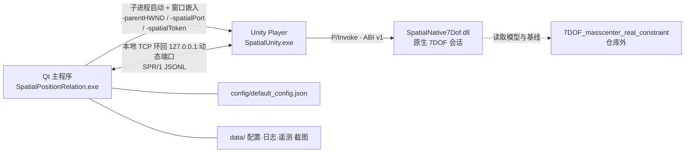

# 空间位置关系计算模块(SpatialPositionRelation)

Qt 主控程序 + 内嵌 Unity 三维视图 + 原生 C++ 7DOF 动力学,用于演示与验证空间在轨场景中的相对位置/姿态关系:双飞行器相对运动、机械臂抓捕搬运、端口接触与锁紧分离、敏感器(CRDS、对接电视相机、机械臂相机)的视场覆盖与遮挡判定,以及太阳翼等可动机构的状态联动。

仓库只包含**源码与工程配置**:约 300 MB Git 对象 + 约 236 MB 走 Git LFS 的模型资源。构建产物(`dist/`、Unity 的 `Library/`/`Build/`、原生插件 DLL)与本地归档目录均不入库。

## 7DOF 演示

当前 Windows 发布使用方案 A:`station` 是己方,拥有七关节机械臂及六路敏感器;`visitor` 是目标,负责初段主动接近。原生 C++ 模块推进接近、机械臂抓捕搬运、端口接触、锁紧和分离,两器均实例化组内 `Assets/Prefabs/服务航天器.prefab`。

- 工况时长 80 s,仿真步长 0.001 s,每 20 步采样,共 4,001 帧。
- 运行 `dist/SpatialPositionRelation.exe` 后,在「位置/机构」页使用播放、暂停、继续、复位与动力学倍率(0.25–16)。
- 事件时刻由原生会话给出:首次工具接触、抓捕、端口接触、首次锁紧请求(58.001 s)、锁紧(58.002 s)、分离。

> Windows 构建原生插件时,工作区必须存在原 7DOF 交付目录 `7DOF_masscenter_real_constraint` 及其 `validation/composite` 基线。该目录**不随本仓库发布**,缺它则原生插件无法重建(DLL 本身也不入库)。

### 验收实测(2026-11-27,构建 `20261127_011953_663`)

| 项目 | 结果 |
| --- | --- |
| 算法自检 | 26 项通过 |
| 原生 vs 归档基线 | 4,001 帧逐帧一致,q 最大差 6.83×10⁻¹² |
| Player 端几何 | 七关节最大 4.285 μm,夹爪 8.377 μm,锁紧端面 0.239 μm |
| 双跑复现 | Windows Player 两次 80 s 末态一致 |

已知边界:未接入原生未来轨迹样本时,遮挡预报列显示无数据;外部交会对接联调已延期。详见 [验收矩阵](SpatialPositionRelation/Docs/ACCEPTANCE_MATRIX.md)。

[构建、坐标与接口](SpatialPositionRelation/Docs/7DOF_构建与接口.md) · [集成门禁](SpatialPositionRelation/Docs/7DOF_集成门禁.md) · [交付文件清单](SpatialPositionRelation/Docs/7DOF_文件清单.md) · [验收矩阵](SpatialPositionRelation/Docs/ACCEPTANCE_MATRIX.md)

## 运行架构



Qt 是宿主:启动时申请一个空闲的本地环回端口,把端口号与一次性实例令牌通过命令行传给 Unity Player,再以 `-parentHWND` 把 Unity 窗口嵌进右侧视口并随窗口尺寸同步。关闭 Qt 主窗口时会一并结束它拉起的 Unity 子进程。

Unity 是原生动力学的载体:`SpatialDynamicsAdapter` 通过 ABI v1 调用 `Spr7_Create` / `Spr7_Advance` / `Spr7_Read` / `Spr7_Destroy`,把原生质心、本体姿态与七关节框架映射到场景节点,再经 SPR/1 报文回传给 Qt 显示。

## 目录结构

```text
.
├─ SpatialPositionRelation/            # Unity 2022.3.62f3 工程
│  ├─ Assets/
│  │  ├─ Scenes/SpatialDemo.unity      # 唯一启用场景(见 EditorBuildSettings)
│  │  ├─ Scripts/                      # 运行时:传输、仿真、动力学适配、敏感器、装配
│  │  ├─ Editor/                       # 编辑器:一键构建、算法自检、冒烟测试
│  │  ├─ Plugins/x86_64/               # SpatialNative7Dof.dll(构建生成,不入库)
│  │  ├─ Model/  Prefabs/  Material/   # 模型与预制体(FBX 走 LFS)
│  │  └─ Spatial/                      # 材质、天空盒、地球贴图
│  ├─ Native7Dof/                      # 原生 7DOF 封装:ABI、会话、构建与回归脚本
│  ├─ Docs/                            # 7DOF 构建接口、集成门禁、验收矩阵、文件清单
│  ├─ ProjectSettings/  Packages/      # 工程设置与包依赖(入库)
│  └─ .vscode/                         # 调试配置
├─ Spatial_Qt/                         # Qt 主控程序
│  ├─ SpatialPositionRelation/
│  │  ├─ CMakeLists.txt  main.cpp
│  │  ├─ mainwindow*.cpp/.h            # 界面、播放器嵌入、状态同步
│  │  ├─ runtimedata.*  telemetrydisplay.*
│  │  └─ config/                       # default_config.json、发布使用说明.md
│  └─ build.ps1                        # 一键构建 → 部署 → 生成 dist/
├─ .gitattributes                      # Git LFS 规则
├─ .gitignore
└─ README.md
```

主要源文件(职责按文件名归纳):

| 文件 | 说明 |
| --- | --- |
| `Assets/Editor/SpatialSceneBuilder.cs` | 命令行构建 Windows x64 Player 的入口 |
| `Assets/Editor/SpatialAlgorithmSelfTest.cs` | 批处理模式下的算法自检,输出 `SPATIAL_ALGORITHM_TESTS_OK` 哨兵 |
| `Assets/Editor/SpatialPlayerSmokeTest.cs` | Player 冒烟测试 |
| `Assets/Scripts/SpatialDynamicsAdapter.cs` | 原生 DLL 的 P/Invoke 适配:世界换基、两器根节点、七关节驱动 |
| `Assets/Scripts/SpatialTcpTransport.cs`、`SpatialTcpBridge.cs` | Qt ↔ Unity 的本地 TCP 传输 |
| `Assets/Scripts/SpatialProtocol.cs` | SPR/1 报文与协议定义 |
| `Assets/Scripts/SpatialSimulation.cs`、`SpatialRuntime.cs` | 仿真推进与运行时入口 |
| `Assets/Scripts/SpatialSensor*.cs` | 敏感器视场、几何与显示 |
| `Native7Dof/Spr7Api.h` | ABI v1:`Spr7Frame` 与四个导出函数 |
| `Native7Dof/build-native.ps1` | 暂存原交付 → 打补丁 → MinGW 构建 → 自检回归 → 投放 DLL |
| `Native7Dof/original.patch` | 仅作用于构建暂存副本的三处改动(原工程零改动) |
| `Native7Dof/regression.py`、`player-regression.py` | 原生 CSV 与 Player 端的回归比对 |

## 环境要求

| 组件 | 版本 / 要求 |
| --- | --- |
| 操作系统 | 64 位 Windows(10/11),需支持 Direct3D 11 的显卡 |
| Unity | 2022.3.62f3(与 `ProjectSettings/ProjectVersion.txt` 一致) |
| Qt | 6.12.0 MinGW 64-bit(CMake 同时兼容 Qt5,实测 Qt6) |
| 编译器 | MinGW-w64 GCC 13.1(x64),Qt 与原生插件共用 |
| CMake | ≥ 3.16 |
| Python | 3.x(`py -3`),仅原生回归脚本需要 |
| 其他 | Git LFS(必需);PowerShell 5.1+(构建脚本) |

Unity 侧依赖 `com.unity.ugui`、`com.unity.textmeshpro`、`com.unity.timeline`、`com.unity.visualscripting` 等,见 `Packages/manifest.json`。

## 获取代码

```powershell
git lfs install
git clone https://github.com/Sujian-Jia/SpatialPositionRelation.git
cd SpatialPositionRelation
git lfs pull
```

> 若未安装 Git LFS,`Assets/Model/展开太阳翼（±y）.FBX` 只会得到 134 字节的指针文本,Unity 中模型会缺失。
>
> 若要构建原生插件,还需另行准备 `7DOF_masscenter_real_constraint/`(含 `Eigen/` 与 `validation/composite/`)放在仓库根目录旁——见下方构建说明。

## 构建

### 方式一:一键构建(推荐)

`Spatial_Qt/build.ps1` 依次执行:原生 Release 自检与基线对照 → Unity 批处理算法自检 → 构建 Windows x64 Player → CMake 配置并编译 Qt Release → `windeployqt` 部署 Qt 运行库 → 复制 Unity Player 与配置到 `dist/` → 写出 `dist/BUILD_VERSION.txt`(含 Qt/Unity 可执行文件与默认配置的 SHA256)。

脚本顶部 4 个绝对路径需改成本机安装位置:

```powershell
$unityExe  = 'D:\Software\Unity\2022.3.62f3\Editor\Unity.exe'
$qtBin     = 'D:\Software\QT\6.12.0\mingw_64\bin'
$mingwBin  = 'D:\Software\QT\Tools\mingw1310_64\bin'
$cmakeExe  = 'D:\Software\QT\Tools\CMake_64\bin\cmake.exe'
```

执行:

```powershell
powershell -ExecutionPolicy Bypass -File .\Spatial_Qt\build.ps1
```

要输出到独立验证目录(不影响 `dist/`):

```powershell
powershell -ExecutionPolicy Bypass -File .\Spatial_Qt\build.ps1 -DistributionDirectory .\dist-verify
```

成功后启动 `dist\SpatialPositionRelation.exe`。构建日志与哨兵(`SPATIAL_ALGORITHM_TESTS_OK`、`SPATIAL_PLAYER_BUILD_OK`)、原生自检日志(`native7dof-*.log`)写在 `Spatial_Qt/SpatialPositionRelation/build/logs/`,该目录不入库;原生 CSV、回归结果与 DLL 在 `Spatial_Qt/SpatialPositionRelation/build/native7dof/`。

### 方式二:分别构建

分别构建时先从工作区根目录生成并验证原生插件。

```powershell
powershell -ExecutionPolicy Bypass -File .\SpatialPositionRelation\Native7Dof\build-native.ps1 -Verify
```

该脚本做四件事:把 `7DOF_masscenter_real_constraint/` 下的 `.cpp`/`.hpp`/`.h` 复制到 `build/native7dof/source/`,在暂存副本内应用 `original.patch`(原目录零改动);用 MinGW + CMake 构建 `spr7_cli.exe` 与 `libSpatialNative7Dof.dll`;`-Verify` 时跑 CLI 两组自检、`arm`/`station` 两工况 CSV,再用 `regression.py` 与 `validation/composite` 基线比对;最后把 DLL 复制为 `Assets/Plugins/x86_64/SpatialNative7Dof.dll`。

**Unity** —— 用 Unity Hub 打开 `SpatialPositionRelation` 子目录即可;首次导入会生成 `Library/` 与 `.sln`/`.csproj`(均被 `.gitignore` 排除,无需提交)。命令行构建:

```powershell
& "C:\Program Files\Unity\Hub\Editor\2022.3.62f3\Editor\Unity.exe" `
  -batchmode -nographics -quit -projectPath .\SpatialPositionRelation `
  -buildTarget Win64 -executeMethod SpatialSceneBuilder.BuildWindowsPlayer `
  -logFile .\unity-build.log
```

产物在 `SpatialPositionRelation/Build/Windows/SpatialUnity.exe`。

**Qt** —— CMake + MinGW:

```powershell
cmake -G "MinGW Makefiles" -S .\Spatial_Qt\SpatialPositionRelation `
      -B .\Spatial_Qt\SpatialPositionRelation\build\Release `
      -DCMAKE_BUILD_TYPE=Release -DCMAKE_PREFIX_PATH="D:\Software\QT\6.12.0\mingw_64"
cmake --build .\Spatial_Qt\SpatialPositionRelation\build\Release --parallel 4
```

编译结果除可执行文件外,还会把 `config/default_config.json` 复制到输出目录的 `config/` 下。要得到可直接分发的目录,还需用 `windeployqt` 补齐 Qt DLL,并把 Unity Player 放到其 `Unity/` 子目录——这正是 `build.ps1` 做的事。

## 运行

1. 双击 `SpatialPositionRelation.exe`,等待右上角显示「Unity 就绪 · TCP 已连接」。
2. 在 Unity 总览左上角勾选多路相机,画面沿右侧纵向排列;双击子视图铺满 Unity 区域,再次双击恢复。选「固定视角」保持预设构图,或选「可拖动视角」用左键环绕、中键平移、滚轮缩放;金色日盘与箭头标出太阳方向。
3. 在「位置/机构」点「播放」运行 80 s 的 7DOF 工况,可暂停、继续、调节动力学倍率或复位。目标器首先主动接近,随后由己方机械臂抓捕搬运,再发生端口接触、锁紧和分离。端口间距、质心间距、轴向间隙、工具距离、七关节角和两器姿态随遥测更新。
4. 勾选「手动检查转轴」后可选择己方、目标或两器,拖动帆板滑块;取消勾选恢复自动对日。勾选「显示射线」可观察敏感器视场线。
5. 需要查看运行情况时点右上角「运行状态」→「查看中文运行记录」,可看到播放、暂停、六个动力学事件与复位的中文记录。
6. 「敏感器」页可保存参数、遥测或相机单帧,也可开始逐帧录制(PNG + 对应遥测)。
7. 关闭 Qt 主窗口,应用会退出它启动的 Unity 子进程。

界面细节见 `Spatial_Qt/SpatialPositionRelation/config/发布使用说明.md`。

## 配置

主配置 `Spatial_Qt/SpatialPositionRelation/config/default_config.json`,构建时复制到程序目录的 `config/`。

| 字段 | 含义 |
| --- | --- |
| `dynamicsSpeed` | 动力学播放倍率,取值 0.25–16 |
| `viewSensorId` | 默认聚焦的敏感器 ID,空串表示不指定 |
| `overviewMode` | 总览模式:`fixed`(固定视角)等 |
| `displaySensorIds` | 默认同时显示的相机列表 |
| `orbit` | 轨道根数(600 km 高度、51.6° 倾角、0.001 偏心率)、时间倍率、闰秒、历元 |
| `sensors[]` | 六路敏感器:类型(`CRDS`/`TV`)、安装位(`ChaserHull`/`ArmWrist`/`ArmElbow`)、视场角、告警阈值 |

早期版本的距离、轨迹点、姿态与关节初值字段已移除——相对运动与关节状态现在完全由原生会话给出,报文中的旧输入不参与动力学计算。

## 7DOF 原生接口

- **SPR/1 报文**:沿用 UTF-8 JSONL 与原有 `state`、`telemetry` 类型。`demoDocking` 控制播放,`demoRunId` 变化时重建会话,`dynamicsSpeed` 取 0.25–16。
- **`telemetry.dynamics`**:含 `timeSec`、`mode`、`jointAnglesRad`、`eventTimesSec`,两器质心/端口位姿与速度、工具位姿;距离字段为 `portDistanceM`、`centerDistanceM`、`axialGapM`、`toolDistanceM`。
- **ABI v1**(`Native7Dof/Spr7Api.h`):`Spr7_Create` 固定选择 `ArmCapture` 与 `RigidComposite`;`Spr7_Advance` 以 20 步为采样边界;`Spr7_Read` 仅在采样边界读取;`Spr7Frame` 为 168 个连续 `double`,四元数按 WXYZ、单位 SI。
- **时钟**:`Spr7_Advance` 每步 1 ms,RK4 固定步长 0.001 s;锁紧设置时刻 58.000 s,首次命令 58.001 s,状态机接受并切锁紧 58.002 s。

坐标与换基约定、模型标定边界(舱体端面、夹爪包围盒、臂段长轴校准)见 [构建、坐标与接口](SpatialPositionRelation/Docs/7DOF_构建与接口.md)。

## 数据与日志

默认写入程序目录下的 `data/`:

- `data/config/user_config.json` —— 用户参数
- `data/logs/` —— 诊断日志(含原始通信与模型标识)
- `data/output/sensors/` —— 遥测与相机图片

数据根目录优先级:`--data-root "<路径>"` > `config/data_root.txt` > `data/`。启动时取消数据目录选择会进入只读模式。

## 仓库约定

- **大文件走 LFS**:`SpatialPositionRelation/Assets/Model/*.FBX`(规则见 `.gitattributes`)。克隆后若模型异常,先执行 `git lfs pull`。
- **与构建无关的产物不入库**:原生插件 `Assets/Plugins/x86_64/SpatialNative7Dof.dll` 由 `build-native.ps1` 生成后忽略,避免把二进制混进源码历史。
- **不入库**:`归档/`、Unity 的 `Library/`、`Temp/`、`Build/`、`Logs/`、`UserSettings/`、`*.csproj`、`*.sln`、`dist/`(发布包)、`7DOF_masscenter_real_constraint/`(外部交付)。理由:可由源码重建,或属于第三方交付,体积远超仓库合理范围。
- **`.gitignore` 采用根目录白名单**:`/*` 忽略根下一切,只放行 `SpatialPositionRelation/`、`Spatial_Qt/` 与 `/.gitignore`、`/.gitattributes`、`/README.md`。新增根级目录时需显式加 `!/目录名/`。
- 行尾:`core.autocrlf=false`(仓库级),保证 Windows 下检出的字节与作者一致。

## 常见问题

| 现象 | 处理 |
| --- | --- |
| Unity 中 FBX 模型空白或尺寸异常 | 未拉取 LFS 内容:执行 `git lfs install && git lfs pull` |
| 启动报找不到 `SpatialNative7Dof.dll`,或 7DOF 无输出 | 仓库不含该 DLL,先跑 `Native7Dof/build-native.ps1` |
| `build-native.ps1` 报 “Native source overlay failed” | 缺少 `7DOF_masscenter_real_constraint/` 或其版本与 `original.patch` 不匹配 |
| `build-native.ps1` 报找不到 `Eigen/Dense` | 原交付目录不完整,需含 `Eigen/` 与 `validation/composite/` |
| 打开工程提示 Unity 版本不符 | 使用 2022.3.62f3;换版本需接受 Unity 的升级流程 |
| 缺少 `.sln` / `.csproj` | 正常,Unity 首次打开工程时自动生成 |
| `build.ps1` 报“Required build tool is missing” | 修改脚本顶部 4 个绝对路径 |
| 文件内容没变却显示已修改 | 检查 `git config core.autocrlf` 是否为 `false` |
| 文档里的验收证据链接打不开 | 证据在作者本地 `归档/验收证据/`,未随仓库发布 |
| 首次 `git push` 被拒(文件超 100 MB) | 新增的大模型必须先 `git lfs track` 再提交 |

## 许可

本仓库未附开源许可证,默认保留所有权利。如需引用、复制或分发,请先联系作者。
