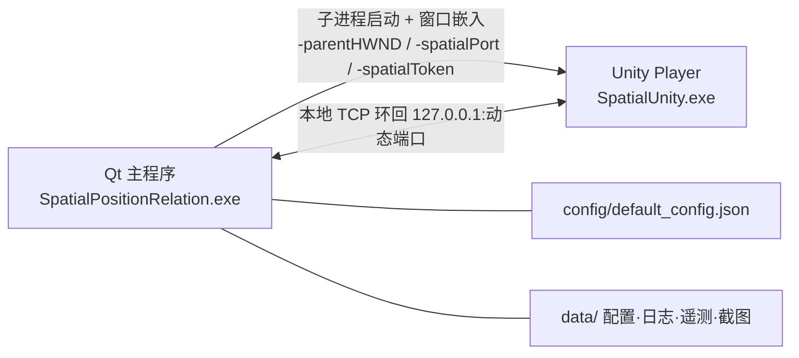

# 空间位置关系计算模块(SpatialPositionRelation)

Qt 主控程序 + 内嵌 Unity 三维视图,用于演示与验证空间在轨场景中的相对位置/姿态关系:双飞行器相对运动、交会对接轨迹、敏感器(CRDS、对接电视相机、机械臂相机)的视场覆盖与遮挡判定,以及太阳翼等可动机构的状态联动。

仓库只包含**源码与工程配置**:约 300 MB Git 对象 + 约 236 MB 走 Git LFS 的模型资源。构建产物(`dist/`)、Unity 缓存(`Library/`、`Build/`)与本地归档目录均不入库。

## 运行架构



Qt 是宿主:启动时申请一个空闲的本地环回端口,把端口号与一次性实例令牌通过命令行传给 Unity Player,再以 `-parentHWND` 把 Unity 窗口嵌进右侧视口并随窗口尺寸同步。关闭 Qt 主窗口时会一并结束它拉起的 Unity 子进程。

## 目录结构

```text
.
├─ SpatialPositionRelation/            # Unity 2022.3.62f3 工程
│  ├─ Assets/
│  │  ├─ Scenes/SpatialDemo.unity      # 唯一启用场景(见 EditorBuildSettings)
│  │  ├─ Scripts/                      # 运行时:传输、仿真、敏感器、装配、多视图
│  │  ├─ Editor/                       # 编辑器:一键构建、算法自检、冒烟测试
│  │  ├─ Model/  Prefabs/  Material/   # 模型与预制体(FBX 走 LFS)
│  │  └─ Spatial/                      # 材质、天空盒、地球贴图
│  ├─ ProjectSettings/  Packages/      # 工程设置与包依赖(入库)
│  └─ .vscode/                         # 调试配置
├─ Spatial_Qt/                         # Qt 主控程序
│  ├─ SpatialPositionRelation/
│  │  ├─ CMakeLists.txt  main.cpp
│  │  ├─ mainwindow*.cpp/.h            # 界面、播放器嵌入、状态同步
│  │  ├─ runtimedata.*  telemetrydisplay.*
│  │  └─ config/                       # default_config.json、发布使用说明.md
│  └─ build.ps1                        # 一键构建 → 部署 → 生成 dist/
├─ .gitattributes                      # Git LFS 规则
├─ .gitignore
└─ README.md
```

主要源文件(职责按文件名归纳):

| 文件 | 说明 |
| --- | --- |
| `Assets/Editor/SpatialSceneBuilder.cs` | 命令行构建 Windows x64 Player 的入口 |
| `Assets/Editor/SpatialAlgorithmSelfTest.cs` | 批处理模式下的算法自检,输出 `SPATIAL_ALGORITHM_TESTS_OK` 哨兵 |
| `Assets/Editor/SpatialPlayerSmokeTest.cs` | Player 冒烟测试 |
| `Assets/Scripts/SpatialTcpTransport.cs`、`SpatialTcpBridge.cs` | Qt ↔ Unity 的本地 TCP 传输 |
| `Assets/Scripts/SpatialProtocol.cs` | 报文与协议定义 |
| `Assets/Scripts/SpatialSimulation.cs`、`SpatialRuntime.cs` | 仿真推进与运行时入口 |
| `Assets/Scripts/SpatialSensor*.cs` | 敏感器视场、几何与显示 |

## 环境要求

| 组件 | 版本 / 要求 |
| --- | --- |
| 操作系统 | 64 位 Windows(10/11),需支持 Direct3D 11 的显卡 |
| Unity | 2022.3.62f3(与 `ProjectSettings/ProjectVersion.txt` 一致) |
| Qt | 6.12.0 MinGW 64-bit(CMake 同时兼容 Qt5,实测 Qt6) |
| 编译器 | MinGW-w64 GCC 13.1(x64) |
| CMake | ≥ 3.16 |
| 其他 | Git LFS(必需);PowerShell 5.1+(仅一键构建脚本需要) |

Unity 侧依赖 `com.unity.ugui`、`com.unity.textmeshpro`、`com.unity.timeline`、`com.unity.visualscripting` 等,见 `Packages/manifest.json`。

## 获取代码

```powershell
git lfs install
git clone https://github.com/Sujian-Jia/SpatialPositionRelation.git
cd SpatialPositionRelation
git lfs pull
```

> 若未安装 Git LFS,`Assets/Model/展开太阳翼（±y）.FBX` 只会得到 134 字节的指针文本,Unity 中模型会缺失。

## 构建

### 方式一:一键构建(推荐)

`Spatial_Qt/build.ps1` 依次执行:Unity 批处理算法自检 → 构建 Windows x64 Player → CMake 配置并编译 Qt Release → `windeployqt` 部署 Qt 运行库 → 复制 Unity Player 与配置到 `dist/` → 写出 `dist/BUILD_VERSION.txt`(含 Qt/Unity 可执行文件与默认配置的 SHA256)。

脚本顶部 4 个绝对路径需改成本机安装位置:

```powershell
$unityExe  = 'D:\Software\Unity\2022.3.62f3\Editor\Unity.exe'
$qtBin     = 'D:\Software\QT\6.12.0\mingw_64\bin'
$mingwBin  = 'D:\Software\QT\Tools\mingw1310_64\bin'
$cmakeExe  = 'D:\Software\QT\Tools\CMake_64\bin\cmake.exe'
```

执行:

```powershell
powershell -ExecutionPolicy Bypass -File .\Spatial_Qt\build.ps1
```

成功后启动 `dist\SpatialPositionRelation.exe`。构建日志与哨兵(`SPATIAL_ALGORITHM_TESTS_OK`、`SPATIAL_PLAYER_BUILD_OK`)写在 `Spatial_Qt/SpatialPositionRelation/build/logs/`,该目录不入库。

### 方式二:分别构建

**Unity** —— 用 Unity Hub 打开 `SpatialPositionRelation` 子目录即可;首次导入会生成 `Library/` 与 `.sln`/`.csproj`(均被 `.gitignore` 排除,无需提交)。命令行构建:

```powershell
& "C:\Program Files\Unity\Hub\Editor\2022.3.62f3\Editor\Unity.exe" `
  -batchmode -nographics -quit -projectPath .\SpatialPositionRelation `
  -buildTarget Win64 -executeMethod SpatialSceneBuilder.BuildWindowsPlayer `
  -logFile .\unity-build.log
```

产物在 `SpatialPositionRelation/Build/Windows/SpatialUnity.exe`。

**Qt** —— CMake + MinGW:

```powershell
cmake -G "MinGW Makefiles" -S .\Spatial_Qt\SpatialPositionRelation `
      -B .\Spatial_Qt\SpatialPositionRelation\build\Release `
      -DCMAKE_BUILD_TYPE=Release -DCMAKE_PREFIX_PATH="D:\Software\QT\6.12.0\mingw_64"
cmake --build .\Spatial_Qt\SpatialPositionRelation\build\Release --parallel 4
```

编译结果除可执行文件外,还会把 `config/default_config.json` 复制到输出目录的 `config/` 下。要得到可直接分发的目录,还需用 `windeployqt` 补齐 Qt DLL,并把 Unity Player 放到其 `Unity/` 子目录——这正是 `build.ps1` 做的事。

## 运行

1. 双击 `SpatialPositionRelation.exe`,等待右上角显示「Unity 就绪 · TCP 已连接」。
2. 在 Unity 总览左上角勾选多路相机,画面沿右侧纵向排列;双击子视图铺满 Unity 区域,再次双击恢复。选「固定视角」保持预设构图,或选「可拖动视角」用左键环绕、中键平移、滚轮缩放;金色日盘与箭头标出太阳方向。
3. 在「位置/机构」选择带可动太阳翼的参考模型并勾选「手动检查转轴」,选择目标、追踪或两器,再拖动滑块;取消勾选恢复自动对日。
4. 视场线默认关闭,勾选「显示射线」并选择机位可观察线束;点「复位」返回演示起点。
5. 「敏感器」页可保存参数、遥测或相机单帧,也可开始逐帧录制(PNG + 对应遥测)。

界面细节见 `Spatial_Qt/SpatialPositionRelation/config/发布使用说明.md`。

## 配置

主配置 `Spatial_Qt/SpatialPositionRelation/config/default_config.json`,构建时复制到程序目录的 `config/`。

| 字段 | 含义 |
| --- | --- |
| `relativeDistanceM`、`demoGapM` | 初始相对距离、演示停靠间隙(米) |
| `trajectoryForecastStepSec`、`demoTrajectoryPoints` | 轨迹预报步长;四段演示轨迹关键点(时间、相对位置、相对姿态) |
| `activePair` | 当前飞行器对:`target`(`SpaceStation`)/ `chaser`(`CrewVehicle`) |
| `sensors[]` | 敏感器:类型(`CRDS`/`TV`)、安装位(`ChaserHull`/`ArmWrist`/`ArmElbow`)、视场角、告警阈值 |
| `jointsDeg` | 太阳翼等机构关节角初值 |
| `orbit` | 轨道根数(600 km 高度、51.6° 倾角、0.001 偏心率)、时间倍率、闰秒、历元 |
| `attitude` | 姿态模式(`euler` 欧拉角 / 四元数) |

## 数据与日志

默认写入程序目录下的 `data/`:

- `data/config/user_config.json` —— 用户参数
- `data/logs/` —— 诊断日志(含原始通信与模型标识)
- `data/output/sensors/` —— 遥测与相机图片

数据根目录优先级:`--data-root "<路径>"` > `config/data_root.txt` > `data/`。启动时取消数据目录选择会进入只读模式。

## 仓库约定

- **大文件走 LFS**:`SpatialPositionRelation/Assets/Model/*.FBX`(规则见 `.gitattributes`)。克隆后若模型异常,先执行 `git lfs pull`。
- **不入库**:`归档/`、Unity 的 `Library/`、`Temp/`、`Build/`、`Logs/`、`UserSettings/`、`*.csproj`、`*.sln`、`dist/`(发布包)。理由:可由源码重建,且体积远超仓库合理范围。
- **`.gitignore` 采用根目录白名单**:`/*` 忽略根下一切,只放行 `SpatialPositionRelation/`、`Spatial_Qt/` 与 `/.gitignore`、`/.gitattributes`、`/README.md`。新增根级目录时需显式加 `!/目录名/`。
- 行尾:`core.autocrlf=false`(仓库级),保证 Windows 下检出的字节与作者一致。

## 常见问题

| 现象 | 处理 |
| --- | --- |
| Unity 中 FBX 模型空白或尺寸异常 | 未拉取 LFS 内容:执行 `git lfs install && git lfs pull` |
| 打开工程提示 Unity 版本不符 | 使用 2022.3.62f3;换版本需接受 Unity 的升级流程 |
| 缺少 `.sln` / `.csproj` | 正常,Unity 首次打开工程时自动生成 |
| `build.ps1` 报“Required build tool is missing” | 修改脚本顶部 4 个绝对路径 |
| 文件内容没变却显示已修改 | 检查 `git config core.autocrlf` 是否为 `false` |
| 首次 `git push` 被拒(文件超 100 MB) | 新增的大模型必须先 `git lfs track` 再提交 |

## 许可

本仓库未附开源许可证,默认保留所有权利。如需引用、复制或分发,请先联系作者。
